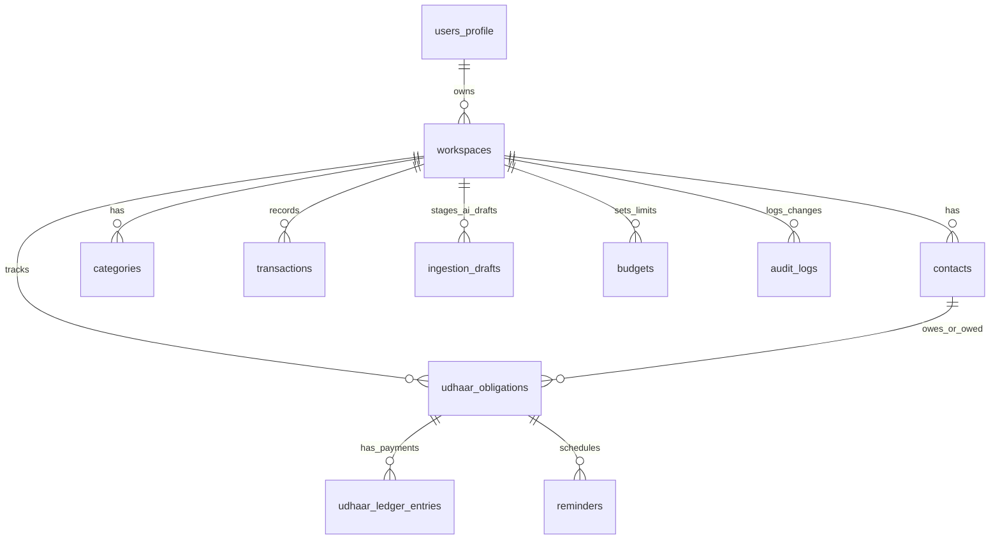

# 🎙️ FinTrack — Complete App Architecture & Step-by-Step Hinglish Workflow

Namaste! **FinTrack** ek next-generation **AI-Powered Voice Expense Tracker aur Digital Udhaar Ledger** Android app hai. Is document mein hum bilkul simple, beginner-friendly **Hinglish** mein samjhenge ki yeh app kaise kaam karega, iska **Cream/Beige & Brown** design kaisa dikhega, iske peeche kaunsi technology use hogi, aur hum step-by-step isko kaise banayenge.

---

## 1. 🎯 App Ka Core Concept & 3 Golden Rules

Fintech (paise ke hisaab-kitaab wale) apps mein **100% accuracy aur bharosa (trust)** sabse zaroori hota hai. Isliye **FinTrack** in **3 Golden Rules** par chalega:

### Rule 1: AI Extracts, Code Calculates, User Confirms (AI Sirf Samjhega, Hisaab Code Karega, Save Aap Karoge)
- **AI ka kaam:** Jab aap mic mein bolenge, bill ki photo kheenchenge, ya UPI notification aayegi, toh AI (Gemini) sirf usme se details nikalega (jaise: *Naam = Ravi, Amount = ₹2,000, Type = Udhaar Diya, Due Date = 10 Nov*) aur ek **Draft (kaccha chitha)** banayega.
- **Code ka kaam:** AI kabhi bhi plus/minus (jod-ghataav) nahi karega kyunki AI kabhi-kabhi math mein galti kar sakta hai. Saari math aur balance calculation humara **TypeScript/SQL code** karega.
- **User ka kaam:** Jab tak aap screen par **[ ✅ Confirm & Save ]** button nahi dabayenge, tab tak koi bhi entry final database mein save nahi hogi.

### Rule 2: Integer Paise Math (`BIGINT` — No Decimal Errors)
- Computers mein decimal numbers (jaise `10.50 + 20.20`) mein kabhi-kabhi `30.70000000004` jaisi floating-point galtiyan ho jaati hain.
- Paise ke hisaab mein `1 paise` ki bhi galti na ho, isliye hum database mein har amount ko **Paise (`BIGINT`)** mein save karenge:
  - `₹1` = `100 paise`
  - `₹250` = `25000 paise`
  - `₹2,000.50` = `200050 paise`
- Screen par dikhate waqt app wapas isko `100` se divide karke sundar `₹2,000.50` dikhayega!

### Rule 3: 2 Separate Modes + Warm Cream/Beige & Brown Aesthetic
App ka look bilkul premium, aankhon ko sukoon dene wala **Warm Cream/Beige aur Rich Brown** shades mein hoga (jaise ek classic leather diary aur modern fintech ka mix):
- **Base Surfaces (Dono Modes Mein):**
  - **Main Background:** Soft Warm Cream (`#FAF6F0`)
  - **Cards & Bottom Sheets:** Rich Sand / Warm Beige (`#F3ECE1`) with subtle Latte Border (`#E2D5C3`)
  - **Primary Text:** Deep Espresso (`#2C1E16`) | **Secondary Text:** Muted Mocha (`#7A6352`)
- **Top Mode Switcher (Dono ka hisaab aur shade alag):**
  1. **🏠 Personal Mode (Warm Coffee & Caramel Brown Theme — Primary `#6F4E37`, Accent `#C88A4B`):**
     - Ghar ke roz ke kharche (Grocery, Rent, Petrol, Chai-Nashta), mahine ki salary/income, monthly budget bars, aur doston/rishtedaron ke saath chota-mota udhaar.
  2. **🏪 Business Mode (Deep Mahogany & Bronze Brown Theme — Primary `#3E2723`, Accent `#9C6B30`):**
     - Dukaan ya chote business ka पक्का (permanent) **Customer & Supplier Udhaar Khata**, kisse kitna lena hai (*You Will Get* — Olive/Sage Green `#3B7A57`), kisko kitna dena hai (*You Will Give* — Terracotta Red `#B84A39`), partial payments, aur WhatsApp payment reminders.
- **Zero Mixing:** Personal aur Business dono alag `workspace_id` par chalenge taaki ghar ka kharcha aur dukaan ka galla kabhi aapas mein mix na ho.

### Rule 4: Zero Hardcoded Dummy Data (100% Live API + TanStack React Query)
- Frontend screens (`PersonalDashboardScreen`, `BusinessDashboardScreen`, `CustomerDetailScreen`) ke andar koi bhi fake array, dummy JSON, ya hardcoded number nahi hoga.
- Mobile app `/mobile/src/services/api.ts` ke zariye `http://<BACKEND_HOST>:5000/api/v1` se live data mangwayegi, jisme har request ke saath `Authorization: Bearer <JWT_TOKEN>` aur `X-Workspace-Id: <WORKSPACE_ID>` jayega.
- **TanStack React Query** hooks (`useDashboardSummary()`, `useUdhaarLedger()`, `useContactsList()`, `useBudgets()`) har screen par **4 explicit states** sambhalenge:
  1. **Loading State:** Animated Cream/Beige Skeleton Loader (koi blank screen nahi).
  2. **Empty State:** Sundar illustration aur 1-tap action button.
  3. **Error State:** Backend unreachable hone par `[ 🔄 Retry ]` button.
  4. **Success State:** Real Supabase database ka data.
- **Database Seeding (`/supabase/seed.sql`):** Agar testing ke liye sample data chahiye, toh woh frontend JS mein nahi balki `/supabase/seed.sql` script ke zariye seedha PostgreSQL database mein jayega.

### Rule 5: Proactive External Credential Checkpoints (No Fake Keys)
- Hum kabhi bhi code mein dummy API keys ya fake auth bypass nahi daalenge.
- Backend start hote hi `zod` (`backend/src/config/env.ts`) check karega ki saari `.env` keys (`SUPABASE_URL`, `SUPABASE_ANON_KEY`, `SUPABASE_SERVICE_ROLE_KEY`, `GEMINI_API_KEY`) sahi hain ya nahi. Agar koi key missing hogi toh server saaf Hinglish/English guide print karega.

---

## 2. 🛠️ Tech Stack Explained Simply (Kaunsa Tool Kya Kaam Karega?)

Hum poore project ko **3 clean folders** mein rakhenge taaki code samajhna aur manage karna bilkul aasaan rahe:

```mermaid
flowchart LR
    subgraph Mobile["📱 /mobile (React Native + Expo)"]
        UI["Cream & Brown UI Screens"]
        Mic["🎙️ Voice & 📷 Camera"]
        Notif["🔔 UPI Notification Listener"]
        SQLite["💾 Local SQLite (Offline)"]
    end

    subgraph Backend["🖥️ /backend (Node.js + Express + TS)"]
        API["Secure API Routes"]
        Gemini["🤖 Gemini AI Service"]
        Math["🧮 Paise Math & Deduplication"]
    end

    subgraph Cloud["☁️ /supabase (PostgreSQL + Auth)"]
        Auth["🔐 User Login / OTP"]
        DB["🗄️ Permanent Tables + RLS"]
    end

    Mobile <-->|"HTTPS JSON"| Backend
    Backend <-->|"SQL / Supabase SDK"| Cloud
```



### 📱 `/mobile` (React Native + Expo + TypeScript)
- **Kya hai:** Yeh humari **FinTrack** Android app hai jo phone mein chalegi.
- **Kya karega:**
  - Sundar Cream/Beige & Brown screens dikhayega (Personal Dashboard, Business Khata, Customer Chat Timeline).
  - Phone ka **Mic** use karke aawaaz record karega aur **Camera** se paper bill scan karega.
  - **Local SQLite Storage:** Agar internet slow hai ya band hai, tab bhi aap app dekh sakenge aur offline drafts rakh sakenge.

### 🖥️ `/backend` (Node.js + Express + TypeScript)
- **Kya hai:** Yeh humara apna secure server (middleman) hai.
- **Kyu zaroori hai:** Agar hum Gemini AI ki secret API key seedha mobile app ke andar daal denge, toh koi bhi hacker app ko tod kar humari key chura sakta hai. Isliye Mobile App apni request `/backend` ko bhejega, aur `/backend` chupchaap Gemini AI aur Database se baat karke result wapas mobile ko dega.

### ☁️ `/supabase` (PostgreSQL Database + Authentication)
- **Kya hai:** Yeh humara online Cloud Database aur Login system hai.
- **Row Level Security (RLS):** Database ke andar ek security lock (`RLS`) laga hoga. Iska matlab hai ki agar App mein 10,000 users hain, toh **User A** sirf apna hi khata dekh aur badal sakta hai — woh galti se bhi **User B** ka data nahi dekh payega.

### 🤖 Google Gemini API (AI Brain)
- **Kya karega:**
  1. **Multilingual Voice Understanding:** Aap Hindi (*"रवि को दो हज़ार उधार दिए"*), Hinglish (*"Ravi ko 2000 udhaar diye"*), ya English mein bolenge, Gemini usko samajh kar clean structured JSON draft bana dega.
  2. **Bill OCR (Vision):** Dukaan ke kachhe ya pakke parchi/bill ki photo padh kar usme se items, date, aur total amount nikalega.

---

## 3. 📱 Screen-by-Screen Design & User Flow (Cream/Beige & Brown Theme)

### A. 🏠 Personal Dashboard Screen (Warm Coffee Brown `#6F4E37` on Cream `#FAF6F0`)
1. **Top Bar:** `[ 🏠 Personal | 🏪 Business ]` warm beige pill switcher aur Notification bell.
2. **Monthly Summary Card:** Rich Roast Brown (`#6F4E37`) card par Cream text mein is mahine ka **Total Spent (Kharcha)** vs **Total Income (Kamaai)**.
3. **🔔 UPI Payments Detected Banner:** Warm Caramel (`#C88A4B`) highlight banner: *"3 new UPI payments detected — Tap to review & save"*.
4. **Personal Udhaar Mini-Card:** Beige card (`#F3ECE1`) par doston se kitna lena hai (`You Will Get: ₹1,500`) aur kitna dena hai (`You Owe: ₹500`).
5. **Budget Progress Bars:** Jaise *Grocery Budget: ₹4,200 / ₹5,000 (84% used)* — Coffee brown progress bar jo 80% ke upar Terracotta/Amber alert dikhayegi.
6. **Recent Transactions List:** Warm beige icons ke saath haal hi ke kharche.
7. **Floating 🎙️ Bada Mic Button:** Bottom navigation ke beech mein Deep Espresso/Coffee (`#5C3A21`) color ka mic button.

### B. 🏪 Business Dashboard — Udhaar Khata (Deep Mahogany `#3E2723` on Cream `#FAF6F0`)
1. **Top Summary Cards (Sabse Zaroori):**
   - 🟢 **You Will Get (Lena Hai):** Total paisa jo market/customers se aana baaki hai (Earthy Sage Green `#3B7A57` accent on Beige card).
   - 🔴 **You Will Give (Dena Hai):** Total paisa jo suppliers/wholesalers ko dena hai (Warm Terracotta Red `#B84A39` accent on Beige card).
2. **Quick Filter Chips:** Beige/Brown pills — `[ All ]`, `[ 🚨 Overdue ]`, `[ ⏰ Due Today ]`, `[ Customers ]`, `[ Suppliers ]`.
3. **Customer/Supplier List:**
   - Har row mein Customer ka naam, net baaki amount, due date badge (*"Due in 2 days"* ya *"Overdue by 3 days"*).
   - Har customer ke bilkul samne ek direct **[ 💬 Remind ]** button jo seedha polite WhatsApp reminder khol dega.

### C. 💬 Customer Detail Screen (WhatsApp-Style Ledger Timeline)
Jab aap kisi customer (maan lijiye **Ravi**) par tap karenge:
1. **Top Header:** Mahogany brown header mein Ravi ka naam, phone number, total **Net Balance (`Remaining: ₹1,000 You Will Get`)**, aur Due Date set/change karne ka option.
2. **Chat Jaisi Timeline (On Warm Cream Wallpaper):**
   - 🔴 **Left Side Bubble (Soft Terracotta Tint `#F9E6E2` with `#B84A39` text — Udhaar Diya / Gave):** *"₹2,000 — Udhaar Diya (1 Nov)"*
   - 🟢 **Right Side Bubble (Soft Sage Tint `#E6F2EB` with `#3B7A57` text — Wapas Mila / Got):** *"₹1,000 — Wapas Mila via UPI (5 Nov)"*
3. **Partial Repayment Tracking:** Agar ₹2,000 ke udhaar mein se Ravi ne ₹1,000 de diye, toh card par saaf dikhega:
   - `Original: ₹2,000` | `Paid: ₹1,000` | **`Remaining: ₹1,000` (Status: PARTIALLY_PAID)**
4. **Bottom Action Buttons:**
   - 🔴 **[ Gave / Maine Diye (₹) ]**
   - 🟢 **[ Got / Mujhe Mile (₹) ]**
   - 🎙️ **[ Bol Kar Entry Karein ]**

### D. 🎙️ AI Voice Bottom Sheet (Bol Kar Hisaab Likhein)
Jab aap **Mic Button** dabayenge, toh neeche se ek Warm Beige (`#F3ECE1`) Bottom Sheet upar aayegi:
1. **Step 1 (Listening):** Aap bolte hain: *"Ravi ko 2,000 rupaye udhaar diye, woh 10 November ko wapas karega."* Screen par live brown/caramel audio waveform dikhega.
2. **Step 2 (Ambiguity Check — Agar Kuch Adhoora Hai):**
   - Maan lijiye aapne sirf bola: *"Ravi ko 500 diye."* (Yeh clear nahi hai ki yeh kharcha hai ya udhaar, ya konsa Ravi hai).
   - Toh AI turant ek chota sa sawal puchega: *"Kya yeh ₹500 Ravi Sharma ko Udhaar diye hain, ya kisi cheez ka pakka payment kiya hai?"*
3. **Step 3 (Draft Transaction Card):**
   - Jab sab clear ho jaye, toh ek **Editable Draft Card** dikhega:
     - **Contact:** Ravi
     - **Type:** Udhaar Given (Lena Hai)
     - **Amount:** `₹2,000.00`
     - **Due Date:** `10 Nov 2026`
   - Neeche 2 buttons honge: `[ ✏️ Edit ]` aur **`[ ✅ Confirm & Save ]`**.

### E. 🤝 Polite Reminder Modal (Pyar Se Paise Maangne Wala Feature)
Dukaandaron aur doston ko sabse zyada jhijhak paise wapas maangne mein hoti hai.
- **24-Hour Due Alert:** Due date se 24 ghante pehle app aapko alert dega ki kal Ravi ke ₹1,000 due hain.
- **Polite Message Composer:** Jab aap `[ 💬 Remind ]` dabayenge, toh 3 bhashaon (**Hinglish, Hindi, English**) aur 2 tones (**Friendly / Formal Business**) mein ready-made message dikhega:
  > *"Namaste Ravi bhai 🙏, FinTrack par aapka ₹1,000 ka balance 10 Nov ko due hai. Jab suvidha ho toh UPI kar dijiyega. Dhanyawad!"*
- Ek tap mein yeh message WhatsApp ya SMS mein Ravi ke number ke saath khul jayega!

### F. 📷 Bill Scanner & 🔔 UPI Notification Detector
1. **Paper Bill Scanner (Camera OCR):**
   - Dukaan ki parchi ya restaurant bill ki photo kheencho -> Gemini Vision usme se Dukaan ka naam, Date, Items, aur Total Amount nikal kar **Draft Card** dikhayega -> Aap `[ Confirm & Save ]` karenge.
2. **Smart UPI Notification Detector (Bina SMS Permission Ke):**
   - Google Play Store ab normal apps ko `READ_SMS` permission nahi deta. Isliye hum Android ka safe aur legal **`NotificationListenerService`** use karenge.
   - Jab bhi GPay, PhonePe, Paytm, ya Bank app ka notification upar aayega (jaise *"Paid ₹180 to Raju Tea Stall via UPI"*), app usko pakad kar ek **Draft** bana dega.
   - **Deduplication (Double Entry Rokna):** Agar ek hi ₹180 payment ka notification GPay se bhi aaya aur Bank se bhi aaya (5 minute ke andar same amount + same reference/merchant), toh humara `dedupe_fingerprint` logic samajh jayega ki yeh ek hi payment hai aur **duplicate draft nahi banayega**!

---

## 4. 🗄️ Database Tables Ka Breakdown (11 Core Tables in Hinglish)

Humare PostgreSQL (Supabase) database mein **11 tables** hongi jo poore **FinTrack** app ka hisaab sambhalengi:



| # | Table Ka Naam | Iska Kya Kaam Hai? (Simple Hinglish Explanation) |
| :--- | :--- | :--- |
| 1 | **`users_profile`** | User ki basic जानकारी (Naam, Phone Number, Preferred Language: Hinglish/Hindi/English, Default Mode). |
| 2 | **`workspaces`** | Har user ke 2 khate banata hai: ek `PERSONAL` workspace aur ek `BUSINESS` workspace. Baaki saari tables isse judi hoti hain. |
| 3 | **`contacts`** | Aapke Customers, Suppliers, aur Doston ki list (Naam, Phone number, Contact Type, aur unka running net balance in paise). |
| 4 | **`categories`** | Kharche aur kamaai ki categories (jaise: *Grocery, Petrol, Rent, Dukaan Stock, Salary*) unke icon aur warm brown/beige color tag ke saath. |
| 5 | **`transactions`** | Roz ke pakke kharche (`EXPENSE`) aur kamaai (`INCOME`). Amount hamesha `amount_paise` (`BIGINT`) mein save hota hai. |
| 6 | **`udhaar_obligations`** | Udhaar ka main record — Kis contact se kitna lena (`RECEIVABLE`) ya dena (`PAYABLE`) hai, `principal_paise` (asli रकम), `remaining_paise` (kitna bacha hai), `due_date`, aur status (`OPEN`, `PARTIALLY_PAID`, `SETTLED`). |
| 7 | **`udhaar_ledger_entries`** | Udhaar ke andar hone wali har ek kist (installment/entry) ka record. Jaise ₹2,000 udhaar diya (Entry 1: `+200000 paise`), phir ₹500 wapas mile (Entry 2: `-50000 paise`), phir ₹500 aur mile (Entry 3: `-50000 paise`). |
| 8 | **`ingestion_drafts`** | **Sabse Khaas Table!** AI Voice, Bill OCR, ya UPI Notification se aaya hua kaccha data pehle yahan save hota hai (`PENDING_CONFIRMATION`). Isme `dedupe_fingerprint` bhi hota hai taaki duplicate UPI notification na ghuse. Jab user confirm karta hai, tabhi yeh `transactions` ya `udhaar_obligations` mein jata hai. |
| 9 | **`budgets`** | Personal mode mein har category ka monthly limit (jaise Grocery = `500000 paise` yaani ₹5,000) track karne ke liye. |
| 10 | **`reminders`** | Kis customer ko kab due-date alert dikhana hai aur WhatsApp reminder kab bheja gaya, uska record. |
| 11 | **`audit_logs`** | Security aur history ke liye — kab kisne konsi entry banayi, edit ki, ya settle ki, uska पक्का सबूत (log). |

---

## 5. 🚀 Step-by-Step Build Phases (Hum Kis Order Mein Code Likhenge?)

Taaki aapko har step samajh aaye aur hum bina kisi confusion ke app banayein, hum poore project ko **5 Phases** mein banayenge:

### 🏗️ Phase 1: Project Setup, Database Schema, Auth & Cream/Brown Theme Switcher
- `/mobile`, `/backend`, aur `/supabase` folders banana.
- Supabase ke liye **`001_initial_schema.sql`** likhna jisme upar batayi gayi 11 tables, `BIGINT` paise constraints, aur Row Level Security (RLS) policies hongi.
- Paise conversion utilities (`rupeesToPaise`, `paiseToRupees`, `formatINR`) banana.
- Mobile app mein **Warm Cream/Beige (`#FAF6F0` / `#F3ECE1`)** base ke saath **Personal Mode (Coffee Brown `#6F4E37`)** aur **Business Mode (Mahogany Brown `#3E2723`)** ka instant theme switcher aur bottom navigation banana.

### 📒 Phase 2: Dashboards, Udhaar Khata, Chat Timeline & Partial Repayment Math
- **Personal Dashboard:** Spent vs Income card, Category Budgets progress bar, aur Recent Transactions.
- **Business Dashboard (Udhaar Khata):** *You Will Get* / *You Will Give* cards, Overdue filters, aur Customer list.
- **Customer Detail Timeline:** WhatsApp chat jaisa Terracotta/Sage bubble ledger on Cream background.
- **Exact Partial Repayment Engine:** Agar ₹2,000 ke udhaar par ₹1,000 wapas aaye, toh code exact `200000 - 100000 = 100000 paise` (`₹1,000 Remaining`) calculate karega aur status ko `PARTIALLY_PAID` karega.

### 🎙️ Phase 3: AI Voice Assistant (Hindi/Hinglish/English) & Follow-up Questions
- `/backend` mein Gemini AI voice parsing route banana.
- Mobile mein **🎙️ Voice Bottom Sheet** banana jisme bolne par waveform dikhe.
- **Ambiguity Resolver:** Agar user ne adhoori baat boli (jaise amount ya naam missing hai, ya kharcha vs udhaar clear nahi hai), toh AI chota sa clarifying sawal puchega.
- **Draft Confirmation Card:** `[ Confirm & Save ]` dabane par hi entry database mein jayegi.

### 💬 Phase 4: 24-Hour Due Reminders & Polite WhatsApp/SMS Composer
- Due date se 24 ghante pehle automatic reminder trigger.
- **Polite Reminder Modal:** Hindi, Hinglish, aur English mein vyavaharik (polite) WhatsApp message generate karna ("FinTrack" naam ke saath) aur direct WhatsApp chat open karna.

### 📷 Phase 5: Camera Bill Scanner (OCR) & Automatic UPI Notification Listener
- **Bill OCR:** Parchi/Bill ki photo kheench kar Gemini Vision se total aur items nikalna -> Draft Card dikhana.
- **Android Notification Listener:** GPay, PhonePe, Paytm, aur Bank notifications se payment detect karna.
- **Smart Deduplication:** Fingerprint matching se duplicate notifications ko rokna aur user ko *"Review Detected UPI Payments"* banner dikhana.

---

## 6. 📋 Aapki Taraf Se Kya Chahiye Hoga? (Beginner Checklist)

Aap bilkul chinta mat kijiye — **99% code main khud likhunga**. Aapko bas 2 free accounts se API keys laakar `.env` file mein rakhni hongi (jab hum un phases par pahunchenge, main aapko exact jagah bhi bata dunga):

### 1. 🟢 Supabase Account (Free Database & Auth Ke Liye)
- **Kahan jana hai:** [https://supabase.com](https://supabase.com) par jaakar free Sign Up karein aur `"FinTrack"` naam ka ek naya project banayein.
- **Kya copy karna hai:** Project Settings -> **API** mein jaakar yeh 3 cheezein milengi:
  1. `SUPABASE_URL` (Aapke database ka address)
  2. `SUPABASE_ANON_KEY` (Mobile app ke liye safe public key)
  3. `SUPABASE_SERVICE_ROLE_KEY` (Sirf `/backend` server ke liye secret key)

### 2. 🔵 Google AI Studio (Free Gemini API Key Ke Liye)
- **Kahan jana hai:** [https://aistudio.google.com](https://aistudio.google.com) par apne Google account se login karein.
- **Kya copy karna hai:** **"Get API Key"** -> **"Create API key"** par click karein aur apni `GEMINI_API_KEY` copy kar lein.

### 3. 📄 `.env` File Mein Kahan Daalna Hoga?
Jab main Phase 1 mein folders banaunga, tab main `/backend/.env.example` aur `/mobile/.env.example` files bana dunga. Aapko bas unme apni keys paste karni hongi, kuch is tarah:

```env
# /backend/.env
PORT=4000
SUPABASE_URL=https://your-project.supabase.co
SUPABASE_SERVICE_ROLE_KEY=your-secret-service-role-key
GEMINI_API_KEY=your-gemini-api-key
```

---

> [!IMPORTANT]
> **Golden Promise:** Hum har phase ko bilkul saaf-suthre tarike se banayenge aur main har step par aapko Hinglish mein samjhata chalunga ki humne kya banaya hai aur woh kaise kaam karta hai!
